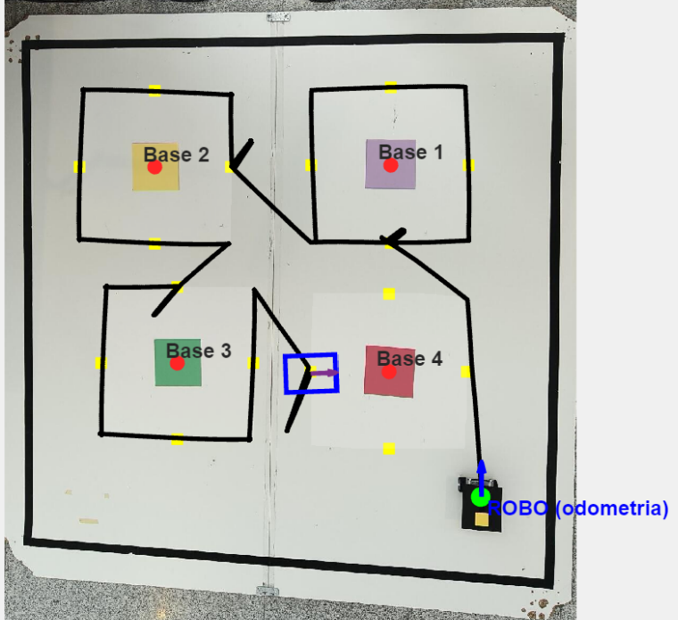
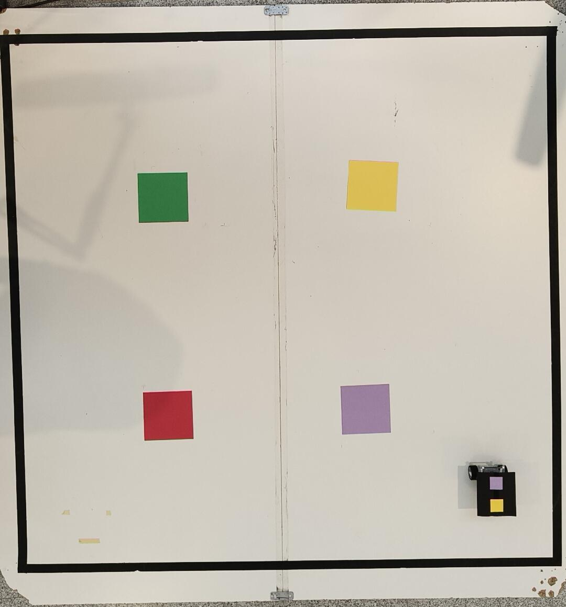
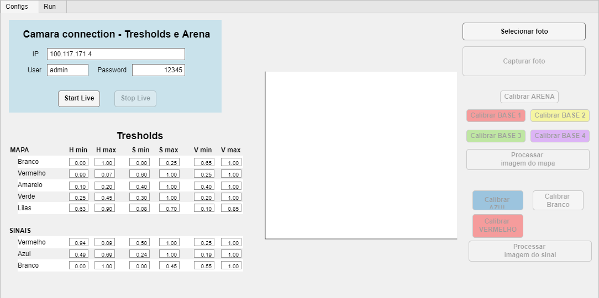
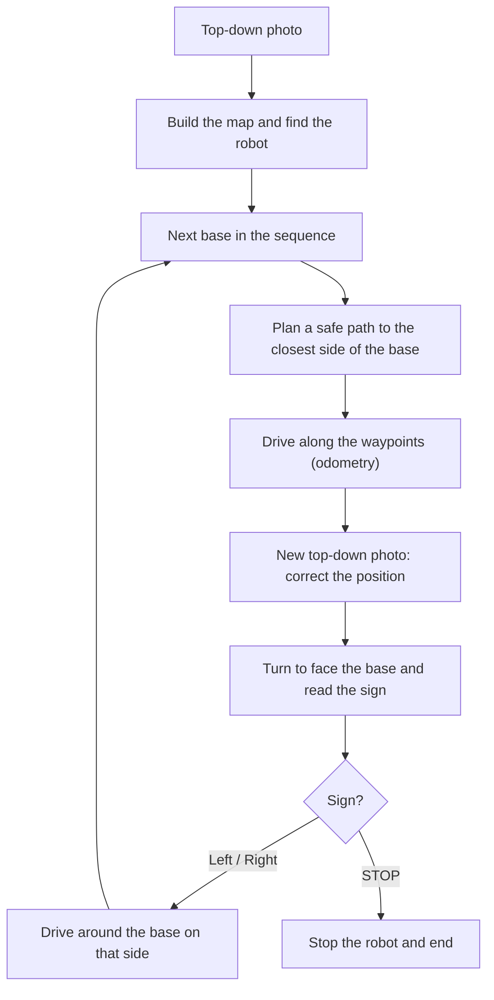
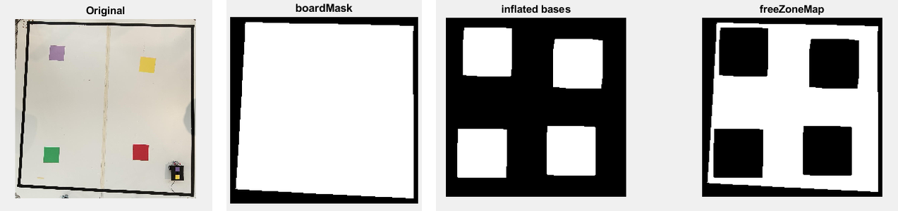
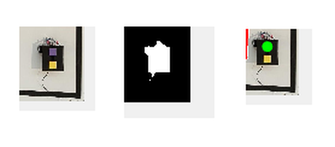
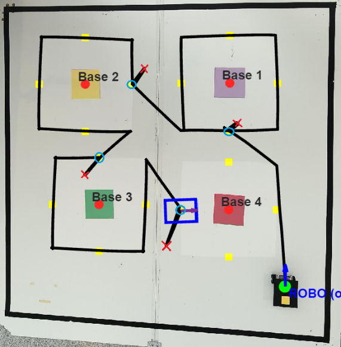
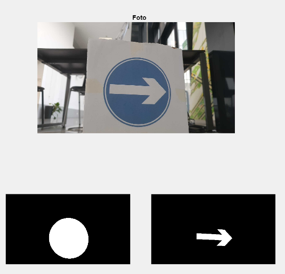
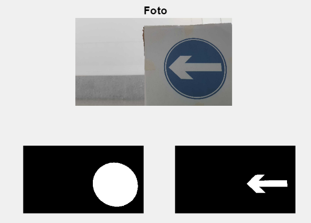
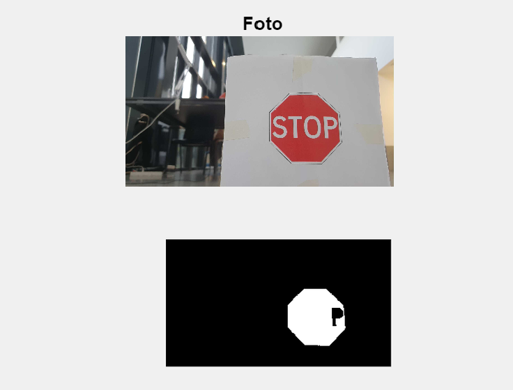

# Autonomous LEGO EV3 Robot: Vision Mapping, Path Planning and Traffic Signs (MATLAB)

A **LEGO Mindstorms EV3** robot that drives by itself around an arena, guided by **computer vision**. A phone above the arena takes **one photo**, and from it the app builds a map: where the arena ends, where the coloured bases (forbidden zones) are, and where the robot is and which way it is facing. The robot then **plans a safe path** to each base, drives there with its own **odometry**, **corrects its position** with a new photo from above, and uses a **second phone mounted on the robot** to read the **traffic sign** on the base. It goes around the base to the left or right as the sign says, and **stops at the STOP sign**.

Everything runs in a **MATLAB App Designer** app on a computer, which talks to the robot over USB and to both phones over Wi-Fi.

<p align="center">
  <br>
  <em>A full autonomous run: the path driven by the robot (black) from its start position, around the bases</em>
</p>

> Project developed for the course **Robotics**, BSc in **Electrical and Computer Engineering**, **Instituto Politécnico do Cávado e Ave (IPCA)**, **3rd year**.

---

## Repository structure

```
.
├── app/
│   ├── APP.mlapp                  # the whole system: interface, vision, planning and control
│   ├── img_1.jpeg                 # sample top-down photo of the arena
│   └── baby-blue.png, black.png, white.png   # images used by the interface
├── simulations/                   # early offline tests of planning and manoeuvres
├── images/                        # figures used in this README
└── README.md
```

The `.png` files must stay in the same folder as `APP.mlapp`, because the interface loads them from there.

---

## The setup

<p align="center">
  <br>
  <em>The arena seen from the top camera, with the four bases and the robot in the bottom-right corner</em>
</p>

- **Robot:** LEGO Mindstorms EV3 with differential drive (two motorized wheels), connected to the computer by **USB**. On top it carries a **black plate with two coloured markers**, a lilac one and a yellow one, so the top camera can find it.
- **Arena:** a white board with a black border and **four coloured sheets** (red, yellow, green and lilac), which are the bases. The robot must reach each base **without driving over it**. Each base has a traffic sign on it: *turn left*, *turn right* or *STOP*.
- **Top camera:** a phone above the arena, looking straight down, used for the map and for relocalization.
- **Robot camera:** a second phone on the robot, used to read the signs.
- **Both phones** stream their camera with the *IP Webcam* app, and MATLAB reads them with `ipcam`.

The bases can be placed anywhere: nothing about their position is hard-coded.

---

## Using the app

<p align="center">
  <br>
  <em>The Configs tab: camera connection, HSV thresholds and calibration buttons</em>
</p>

The app has two tabs, **Configs** and **Run**.

**Configs: prepare the map**

1. Enter the IP, user and password of the top camera and press **Start Live**.
2. With the robot at its start position, press **Capturar foto** to take the top-down photo, or use **Selecionar foto** to load a saved one.
3. Calibrate the colours: press **Calibrar ARENA** and each **Calibrar BASE**, and click 10 points of that colour on the photo. The HSV thresholds are filled in automatically, with a safety margin, and can also be edited by hand.
4. Do the same for the sign colours (**Calibrar VERMELHO**, **AZUL**, **Branco**) on a photo of a sign.
5. Press **Processar imagem do mapa** and **Processar imagem do sinal** to check the masks before running.

**Run: start the robot**

1. Load the map photo with **Carregar mapa**. The app draws the bases, the approach points and the robot's position and heading.
2. Enter the IP of the robot camera and press **START**.
3. The robot runs the whole sequence by itself. At each base, MATLAB's Command Window asks you to confirm its position and the sign it read (press **Enter** to accept).
4. The log on the screen follows every step: target base, corrections, sign read and decision.

### Requirements

- MATLAB with **App Designer**
- **Image Processing Toolbox**
- **MATLAB Support Package for LEGO MINDSTORMS EV3 Hardware**
- **MATLAB Support Package for IP Cameras** (`ipcam`)
- **Navigation Toolbox**, only for the scripts in `simulations/`
- Two smartphones with the **IP Webcam** app, on the same Wi-Fi network as the computer

---

## How it works

The robot itself only drives the motors and reports the encoder readings. All the "thinking" (vision, mapping, planning and control) happens in MATLAB on the computer, because the EV3 brick doesn't have the power to process images in real time.

One complete run looks like this:



### 1. Mapping the arena from one photo

The top-down photo is converted from RGB to **HSV**, where the colour (hue) is separate from the brightness. This makes colour detection much less sensitive to shadows and lighting changes. Then:

- **The arena** is the largest white region (`boardMask`), cleaned with morphological operations.
- **The bases** are found by their colour, each with its own calibrated HSV threshold, and cleaned with noise removal, closing and hole filling.
- **The robot** is found as a black blob with the two markers inside. The **lilac marker gives its position**, and the **line from the yellow marker to the lilac one gives its heading**. Before the bases are processed, the markers are removed from the yellow and lilac base masks, so the robot isn't mistaken for a base.

<p align="center">
  <br>
  <em>From photo to map: original image, arena mask, inflated bases and the free zone where the robot may drive</em>
</p>

**Forbidden zones with a safety margin.** Each base is **inflated** (dilated) by roughly the size of the robot. The free zone, where the robot is allowed to drive, is the arena minus the inflated bases. Because the margin is already in the map, any path planned in the free zone keeps the whole robot, not just its centre, off the bases.

**Approach points and corners.** From the inflated square around each base, the app takes **4 approach points** (the middle of the North, South, West and East sides) and **4 corners**. The approach points are where the robot stops to read the sign, and the corners are used to drive around the base.

**From pixels to millimetres.** The real size of the red base is known (200 mm). Its size in pixels gives the **scale** (millimetres per pixel) for converting between the image and the real world. The image's Y axis points down while the world's Y axis points up, so the conversion flips it.

<p align="center">
  <br>
  <em>Finding the robot: the markers on its black plate, the robot mask and the detected centre</em>
</p>

### 2. Kinematics and odometry

The robot is a **differential drive**: it moves by changing the speeds of its two wheels.

- **Inverse kinematics** turns the motion we want (forward speed `v` and turning speed `ω`) into the speed of each wheel:

```math
\omega_L = \frac{v - \omega \, b / 2}{r} \qquad \omega_R = \frac{v + \omega \, b / 2}{r}
```

- **Forward kinematics** does the opposite. It is used for **odometry**: every 50 ms the app reads both encoders, computes how far the robot moved and turned, and adds that to its position and heading. The motion is integrated as an **arc**, not a straight line, which keeps the estimate more accurate when the robot is turning while it moves.

Here `r` is the wheel radius (27.5 mm) and `b` the distance between the wheels (118 mm).

Odometry is fast but slowly drifts: small wheel slips add up. That is why the position is corrected with the top camera at every base (step 5).

### 3. Path planning

The next base is chosen from a list defined in software, so the order can be changed without touching the arena. For that base, the robot heads to the **approach point closest to where it is**. The path is then planned on the free zone:

1. **Distance field.** Starting from the robot, the app computes for every free pixel the length of the shortest path that reaches it **without leaving the free zone** (a geodesic distance, `bwdistgeodesic`).
2. **Backtracking.** Starting from the target, it repeatedly steps to the neighbouring pixel with a smaller distance until it gets back to the robot. This gives a valid path, but a pixel-by-pixel one full of zig-zags.
3. **Line-of-sight simplification.** From each point, the app jumps to the furthest point that can be reached in a **straight line that stays entirely in the free zone**, and drops everything in between. This removes most of the intermediate points.
4. **Fixed number of waypoints.** The path is adjusted to exactly **5 points** (start, 3 intermediate, target), adding or removing points without ever crossing a forbidden zone.

If the start or target falls inside a forbidden zone (for example, because of a small odometry error), it is first moved to the nearest free pixel.

### 4. Driving to a point

A **drive-to-point controller** takes the robot through the waypoints one by one. On each 50 ms cycle it calculates the distance and the angle to the next point and turns them into `v` and `ω`. Several details make it smooth and repeatable:

- **Rotate first, then drive:** if the robot is facing too far away from the target, it stops and turns in place. Two thresholds (hysteresis) keep it from switching back and forth, and a timeout avoids getting stuck turning.
- **Slow down near the target** and **slow down the turn near the right angle**, to avoid overshooting.
- **Angular dead zone:** very small angle errors are ignored, which removes wobbling.
- **Speed ramp:** the wheel speeds can only change a little per cycle, so the robot doesn't jerk.
- **Minimum speed:** enough to overcome friction, so the robot never stalls just short of the goal.
- **Speed limits** on the wheels, for precision over speed.

### 5. Arriving at a base: relocalization

When the robot reaches the approach point, the app:

1. Takes a **new photo from the top camera**, finds the robot's markers again and **replaces the odometry estimate with the measured position and heading**.
2. Drives again to the approach point, now from the corrected position.
3. **Turns in place to face the centre of the base**, so the sign is in front of the robot camera.
4. **Resets the odometry** to the known coordinates of that approach point, so every base starts from a clean position.

<p align="center">
  <br>
  <em>Relocalization at each base: ✕ is where the camera saw the robot, ○ is the position after the automatic correction</em>
</p>

### 6. Reading the sign

The robot camera takes a picture of the sign. The image is converted to HSV and masks are made for **red**, **blue** and **white**:

- **STOP:** enough **red** in the image, and **white** (the letters) inside the largest red shape.
- **Arrow:** enough **blue**. The app keeps the largest blue shape and the largest white shape inside it (the arrow). If the **centre of the arrow is to the right of the centre of the sign**, the arrow points **right**, otherwise **left**. An arrow has more of its area on the side its head points to.

If no sign is found, the robot **turns 20° to the left and tries again, then 20° to the right**. This helps when the robot arrives at an angle or there is glare on the sign.

<p align="center">
  
  
  <br>
  <em>Turn right, turn left and STOP: camera image and masks used to decide</em>
</p>

### 7. Acting on the sign

- **Left / Right:** the robot **goes all the way around the base**, corner to corner, starting on the side the arrow points to. The order of the corners depends on the side it arrived from and on the direction of the arrow. At each corner it turns in place to face the next one and then drives straight. After the full loop it moves on to the next base.
- **STOP:** the loop ends, the motors stop and the program finishes in a controlled way.

---

## Key points

- **The whole map comes from a single photo.** Arena, bases, robot position and heading, and the pixel-to-millimetre scale are all extracted automatically, so the bases can be anywhere.
- **Safety is built into the map.** The bases are inflated by the size of the robot, so every planned path is safe by construction.
- **Odometry plus vision.** The encoders give a fast, continuous position, and the top camera corrects the drift at every base.
- **Path planning without a graph library:** a geodesic distance field, backtracking and line-of-sight simplification, written from scratch.
- **A smooth controller:** rotate-then-drive with hysteresis, ramps, dead zone and minimum speeds.
- **Robust sign reading:** rule-based colour and shape analysis, with retries at different angles.
- **Calibration in the app:** every colour is calibrated by clicking on the image, so the system adapts to the lighting without changing the code.

---

## Results

- The robot completed full runs, visiting all the bases in the defined order, **without driving over any base**, until it reached the STOP sign.
- It reached the waypoints with an average error of about **2–3 cm**.
- The line-of-sight simplification removed about **40–50%** of the intermediate path points.
- A run with 4 bases took about **3–5 minutes**, and more than **85%** of the test runs succeeded.

---

## Notes

- **Lighting** is the biggest challenge for the vision. Recalibrating the colours on site makes a big difference.
- **Manual checks:** the app currently asks the user in the Command Window to confirm the robot's position and the sign at each base, and lets the user correct the sign if it was misread. This was kept as a safety net during testing.
- **Static map:** the map is built once, at the start. If a base is moved during the run, the robot won't notice. The extra photos are only used to relocate the robot, never to change the map.
- **Simulations:** the scripts in `simulations/` are early offline tests. They try out path planning with a probabilistic roadmap (PRM) and the manoeuvre logic before these were built into the app.
- The interface, comments and log messages are in Portuguese.

---

## Author

**Ivo Azevedo & Tiago Oliveira**
